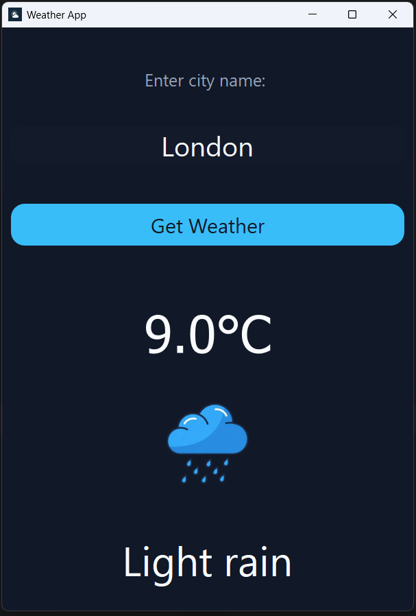

# Python-Weather-app
A Pythyon Weather app, made with PyQt5.

Weather App 🌤️

A simple desktop weather application built with Python and PyQt5. It allows users to search for a city and view its current weather information.

Features

Search for weather by city name
Display current temperature
Show weather conditions and description
Display weather icons
Custom GUI design using Qt Stylesheets (QSS)
Press Enter to search
Basic error handling for invalid city names and API requests

Technologies Used
Python – Main programming language
PyQt5 – Graphical user interface
Requests – HTTP requests to the weather API
OpenWeatherMap API – Weather data
Qt Stylesheets (QSS) – Application styling

Installation
Clone the repository:
git clone YOUR_REPOSITORY_URL

Navigate to the project directory:
cd YOUR_PROJECT_FOLDER

Install the required packages:
pip install PyQt5 requests

Configure your OpenWeatherMap API key using an environment variable.

Run the application:
python main.py

What I Learned
This project helped me practice:
Working with Python classes and functions
Building desktop applications with PyQt5
Working with external APIs and JSON data
Handling exceptions
Organizing code into multiple files
Connecting GUI elements to functions using signals and slots

